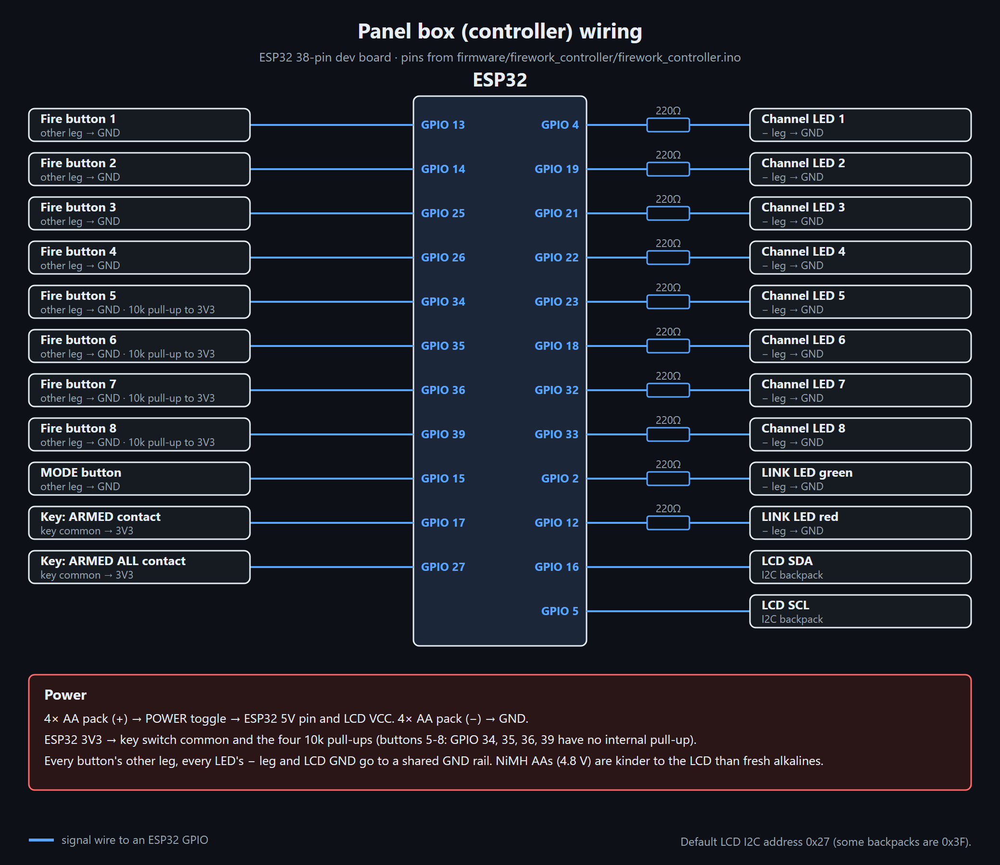
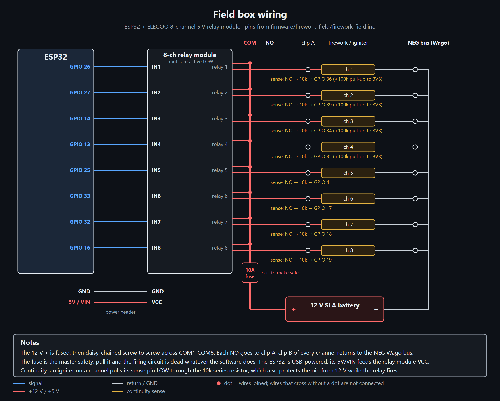

# KaBoomBox

**An ESP32 wireless firework firing system.** A two-box remote firing system for small
firework and effects shows. A handheld panel with
8 fire buttons and an arming key talks over ESP-NOW to a field box with an 8-channel
relay board and a 12 V battery. The field box checks each igniter for continuity and
reports back, so you can see on the panel which channels are ready before you arm.

> [!CAUTION]
> **This fires pyrotechnics. It can hurt or kill people.** It's a hobby project, not a
> certified product, and it comes with no warranty of any kind. Read
> [DISCLAIMER.md](DISCLAIMER.md) before you build or use anything here. You are
> responsible for following the laws where you live. Never bypass the fuse, the arming
> key or the heartbeat auto-disarm.

> [!WARNING]
> **Work in progress.** I'm still actively changing and revising this project. The PCBs,
> printed parts, firmware and docs here are **not final** and may have mistakes or not
> match each other. The current PCB revisions may not have been built or tested yet. If you order boards,
> print parts or build any of this, you do it **at your own risk**: check every file
> yourself first, and expect that things may change after you've built them.

<p align="center">
  
  
  
</p>

## How it works

```
  PANEL BOX (handheld)                          FIELD BOX (on the ground)
 ┌──────────────────────┐    ESP-NOW 2.4 GHz    ┌───────────────────────────┐
 │ ESP32                │ ── heartbeat/fire ──► │ ESP32                     │
 │ 8 fire buttons + LEDs│ ◄── status/contin. ── │ 8-ch relay board          │
 │ arming key, MODE btn │                       │ continuity sense per ch.  │
 │ 16x2 LCD, link LEDs  │                       │ 12 V SLA ─ fuse ─ relays  │
 │ 4x AA                │                       │          └─► igniters     │
 └──────────────────────┘                       └───────────────────────────┘
```

- The panel sends a heartbeat every 300 ms with the key position. The field box only
  fires while it's hearing a fresh ARMED heartbeat. If the heartbeat is more than 1.5 s
  old it cuts any pulse in progress and refuses new fire commands.
- The field box sends status 4 times a second: continuity for each channel, which relays
  are closed, and its uptime. The panel uses that to light the channel LEDs and to work
  out link quality.
- The two boards are paired by MAC address, and every packet is signed with a secret key
  that only your two boxes have. The field box ignores anything it can't verify,
  including packets someone recorded earlier and plays back.

### Key switch

| Position | What happens |
|---|---|
| Middle: **DISARMED** | Every relay open. MODE opens the settings menu. |
| Left: **ARMED** | Each button fires its own channel (SINGLE), or any button runs your saved sequence (PROGRAM). |
| Right: **ARMED ALL** | Any button starts a 3-2-1 countdown, then fires every ready channel. Turning the key aborts it. |

After power-up the key has to be seen in DISARMED once before it will arm, so the box
can't come up armed if you switch it on with the key in the wrong spot.

### Channel types

Each channel can be set in the menu (saved in flash):

- **FIRE**: pulses the relay for the channel's pulse length (0.1 to 10 s). For igniters.
- **ON/OFF**: press on, press off. For lights or inflatables.
- **HOLD**: relay on only while you hold the button. For fog or similar.

Picking ON/OFF or HOLD also sets that channel's "needs continuity" to NO, so it works
without anything on its sense wire. You can change that back in Channel setup.

### Two ways to use a channel

**12 V pyro (the default).** Channel type FIRE. The relay switches the fused 12 V
firing bus to an igniter on alligator clips. This is what the wiring diagrams and
[`docs/FIELD_WIRING_GUIDE.html`](docs/FIELD_WIRING_GUIDE.html) show. E-matches are
about 1-2 Ω. Steel-wool bench igniters need a 1-2 s pulse.

**120 V wall power (optional).** Channel type ON/OFF or HOLD. One relay switches the
hot wire of an ordinary extension cord, so you can turn on inflatables, lights, a fog
machine or anything else that plugs into a wall. This needs its own wiring and a list
of must-do safety steps: see [120 V wall-power channel](#120-v-wall-power-channel-optional)
before you try it. How the firmware treats that channel:

- **ARMED ALL never turns it on.** Fire-all only launches FIRE channels.
- **Turning the key to DISARMED switches it off**, along with every other ON/OFF and
  HOLD channel.
- **If the radio drops**, the menu's **Link-lost hold** setting decides how long the
  device stays on (default: off at once). HOLD channels always go off at once.
- **It shows "no continuity".** That's expected, because its sense wire is left
  disconnected on purpose.

### Menu (key in DISARMED, press MODE)

btn1 = next, btn2 = back, btn3 = minus, btn4 = plus/start, MODE = back, hold MODE = exit.

1 Link status · 2 Ping test · 3 System check · 4 Continuity · 5 Channel setup ·
6 Link-lost hold · 7 Input test · 8 Info · 9 Reset settings

## What's in here

```
firmware/
  firework_controller/   panel box sketch
  firework_field/        field box sketch
hardware/
  pcb/                   KiCad 10 boards, generator + router scripts, gerber zips
  enclosure/             build123d scripts, STEP/STL files, print/fit test pieces
    plate-source/        the faceplate as drawn in CAD, which the scripts build on
docs/                    wiring sheets (.html, open in a browser)
  images/                photos and wiring diagrams
```

## Parts list

What one complete set uses. The search terms are what to type into Amazon/AliExpress.

### Panel box (handheld)

| Qty | Part | Search for / notes |
|---|---|---|
| 1 | ESP32 38-pin dev board | "ESP32 NodeMCU ESP-32S 38 pin" |
| 1 | ESP32 screw-terminal breakout board | "ESP32 38 pin terminal expansion board". Saves soldering, every wire gets a screw |
| 1 | 16x2 LCD with I2C backpack | "1602 LCD I2C PCF8574". Address 0x27 or 0x3F |
| 1 | 3-position key selector switch, 22 mm | "22mm 3 position key selector switch XB2". Needs **two NO contact blocks** (YJ139-XB2 or similar), one per armed position |
| 8 | Momentary push buttons | Fire buttons. Any panel-mount momentary NO button |
| 1 | Momentary push button | MODE |
| 1 | Toggle switch with safety cover | Power. Mine is a KN3C-101 with the flip-up red cover |
| 8 | LEDs | Channel ready/on |
| 1 + 1 | Green LED, red LED | LINK status |
| 10 | 220 Ω resistors | One per LED |
| 4 | 10 kΩ resistors | Pull-ups for buttons 5-8 |
| 1 | 4x AA battery holder | NiMH rechargeables recommended |
| 1 | Half-size breadboard or perfboard | Resistors, LEDs, power rails |
| 1 | Case | I used a small lockable document case; the printed plate drops into a 9-3/8 x 6-1/4 in opening |
| 8+ | M2 x 6 screws | 4 plate-to-legs, 4 tray-to-legs, more if you screw boards down |

### Field box

| Qty | Part | Search for / notes |
|---|---|---|
| 1 | ESP32 38-pin dev board | Same as above, plus a screw-terminal breakout if you like |
| 1 | ELEGOO 8-channel 5 V relay module | Inputs are active LOW |
| 1 | 12 V SLA battery | Firing power, kept separate from the ESP32 power |
| 1 | Inline fuse holder + 10 A fuse | **The master safety.** No fuse, no firing power |
| 4 | 100 kΩ resistors | Sense pull-ups, channels 1-4 |
| 8 | 10 kΩ resistors | Sense series resistors, one per channel |
| 2-3 | Wago 221 5-slot lever connectors | The shared negative return bus |
| 16 | Alligator clips + wire | Two per channel |
| 1 | USB power source + cable | Powers the field ESP32 (a small power bank works) |
| 1 | Ammo can | About 11 in inside length; the printed floor and front window frame fit it |

**Wire size at the relay board:** the ELEGOO screw terminals take about 16-18 AWG at
most. 14 AWG doesn't fit. If your leads are thicker, use a short 16/18 AWG pigtail or
a ferrule into the terminal.

### Optional: parts for a 120 V wall-power channel

Only if you want one channel to switch a wall device. US 120 V only. Prices are rough
(Nov 2026).

| Qty | Part | Search for / notes | ~$ |
|---|---|---|---|
| 1 | Female cord-end plug, 15 A 125 V, 3-prong | "Leviton 515CV" (515CV-OR is orange). Listed for SJ 16/3 cord | 6 |
| 1 kit | 5x20 mm inline fuse holders (18 AWG, 250 V) + assorted 250 V glass fuses | "5x20mm fuse holder inline screw type with wire combo kit". The XFFCSEC kit has 5 holders and 150 fuses, including 5 A, 6.3 A and 7 A | 10 |
| 1-2 | Old PC power cord (18 AWG, 3-wire), computer end cut off | Reuse one. Or cut a 3 ft 16/3 extension cord in half: that gives you the male and the female end, and you can skip the Leviton | 0-8 |
| 2 | Wago 221 lever nuts | Already in the field box list | - |
| opt | Plug-in GFCI adapter | "plug in GFCI adapter". Skip it if the outlet you use is already GFCI | 12-15 |
| opt | 18 AWG ferrules + crimper | "18 AWG ferrules crimper kit" | - |

A PC cord is usually 18/3, thinner than the 16/3 the Leviton is made for. Tighten its
cord clamp hard and give it a tug. The fuse holder leads go straight into the ELEGOO
screw terminal: twist the strands or crimp a ferrule on. **Don't tin them with
solder**, which loosens under a screw over time.

### Optional

| Qty | Part | Notes |
|---|---|---|
| 2 | PCBs | Replace the breadboards: controller 100 x 84 mm, field 100 x 75 mm. See [PCBs](#pcbs) |
| - | Screw terminals (5.08 mm), 1x19 female headers, 1x10 pin header | For the PCBs |
| - | PETG or ASA filament | For the printed parts |

<p align="center">
  
  
  
  
</p>

## Flashing the firmware

1. Install the [Arduino IDE](https://www.arduino.cc/en/software).
2. Add the ESP32 boards: **File → Preferences → Additional boards manager URLs**:
   `https://espressif.github.io/arduino-esp32/package_esp32_index.json`
   then **Tools → Board → Boards Manager**, search "esp32" and install **esp32 by
   Espressif Systems**. The sketches handle both the 2.x and 3.x cores.
3. **Sketch → Include Library → Manage Libraries**, install **LiquidCrystal I2C** by
   Frank de Brabander (panel box only).
4. Board: **ESP32 Dev Module**. Open `firmware/firework_controller/firework_controller.ino`,
   upload it to the panel ESP32. Open `firmware/firework_field/firework_field.ino` and
   upload it to the field ESP32.

### Your secret key (do this first)

The boxes sign every message with a key only they know, so nobody else can make a fake
panel that your field box would obey. The sketches won't compile until you make one.

1. Copy `secrets.example.h` to `secrets.h` in `firmware/firework_controller/`.
2. Make a random key. In a terminal:

   ```bash
   python -c "import secrets; print(', '.join('0x%02X' % b for b in secrets.token_bytes(32)))"
   ```

   Paste the 32 numbers into `secrets.h` and set `KABOOM_KEY_IS_PLACEHOLDER` to `0`.
3. Copy that same `secrets.h` into `firmware/firework_field/`. Both boxes need the
   **same** key.

Keep `secrets.h` to yourself. It's in `.gitignore`, so it won't be uploaded if you fork
this repo. If the two boxes have different keys they won't link, and the LCD says
`FW/SECRET DIFFER`.

### Pairing the two boards

The MAC addresses in the sketches are for my boards. Yours will be different.

1. Flash both sketches (with your `secrets.h`) and open **Serial Monitor at 115200 baud**.
2. Each board prints its own MAC at boot (`MY MAC - paste into ...`).
3. Put the **field** board's MAC into `FIELD_MAC` in `firework_controller.ino`.
4. Put the **controller** board's MAC into `CONTROLLER_MAC` in `firework_field.ino`.
5. Re-flash both. The green link LED should come on.

`44:1D:64:BD:75:50` becomes `{0x44, 0x1D, 0x64, 0xBD, 0x75, 0x50}`.

### Settings you might change

| Setting | File | Default | What it does |
|---|---|---|---|
| `FIELD_MAC` | firework_controller.ino | my board | MAC of your field box |
| `CONTROLLER_MAC` | firework_field.ino | my board | MAC of your panel box |
| `LCD_ADDR` | firework_controller.ino | `0x27` | Try `0x3F` if the screen stays blank (and turn the contrast pot) |
| `USE_LONG_RANGE` | **both** | `0` | `1` turns on ESP32 long-range mode. Must match on both boards |
| `MAX_PULSE_MS` | firework_field.ino | `10000` | Hard cap on any one pulse, whatever the panel asks for |
| `HEARTBEAT_TIMEOUT` | firework_field.ino | `1500` | Field disarms after this many ms without a heartbeat. Don't raise it |

Everything else (channel types, pulse lengths, continuity check, link-lost hold, the
saved sequence) is set from the menu on the panel and stored in flash.

If you change the message format, bump `PROTO_VER` in both sketches. Boards with a
different `PROTO_VER` ignore each other instead of misfiring. Version 3 (`0xA3`) added
the signing, so a v2 box won't talk to a v3 box: flash both.

## Wiring

The pin numbers in these diagrams match the sketches. The step-by-step sheets in
[`docs/`](#docs) go wire by wire.





<p align="center">
  
  
</p>

### 120 V wall-power channel (optional)

> [!CAUTION]
> **Wall power can kill you, and a mistake here can put 120 V on the igniter clips or
> the ESP32.** Only do this if you're comfortable wiring mains, and go through every
> step in the checklist below. US 120 V only: 230 V countries need different plugs,
> wire colours and fuse values. If you're unsure, use a ready-made relay outlet box
> that takes a low-voltage control input instead.

**How it works:** the relay switches only the **hot** wire of an ordinary cord. Neutral
and ground go straight through on Wagos and never touch the relay board. The example
uses channel 8.

| From | Through | To |
|---|---|---|
| Wall plug **HOT** (narrow blade, usually black) | Inline fuse holder, 250 V, 5 A slow-blow | Relay **COM8** |
| Relay **NO8** | | Female plug **HOT** (brass screw) |
| Wall plug **NEUTRAL** (wide blade, usually white) | Wago | Female plug **NEUTRAL** (silver screw) |
| Wall plug **GROUND** (green) | Wago | Female plug **GROUND** (green screw) |
| Channel 8 continuity-sense wire | | **Nothing.** Leave that sense terminal empty |

Before you cut anything, check with a continuity meter which wire goes to the narrow
blade. Don't trust the colours alone.

In the menu, set channel 8 to **ON/OFF** (or HOLD) under **Channel setup**. Then, with
the key in ARMED, button 8 turns the outlet on and off.

**Must-do checklist** (every one of these, every build):

1. **Remove CH8's COM jumper.** All the other COMs are tied to the 12 V firing bus. If
   CH8's COM stays jumpered, 120 V lands on every channel's igniter clips.
2. **Disconnect CH8's sense wire** (on a breadboard, take out its 10 kΩ series
   resistor). Through that resistor 120 V would reach the ESP32 pin, kill the board and
   make the whole low-voltage side live. The 10 kΩ only protects against 12 V.
3. **Unplugging the 12 V battery doesn't make shared wiring safe.** Steps 1 and 2 are
   needed even if 12 V and 120 V are never connected at the same time.
4. **Switch the hot only**, never the neutral.
5. **The fuse must be rated 250 V.** Don't reuse the 12 V system's automotive blade
   fuse: blade fuses are rated 32 V and can keep arcing on wall power instead of
   breaking the circuit.
6. **Fuse size:** start at 5 A. If a fast-blow pops when a blower motor starts, step up
   to 6.3 A, then 7 A. Never go above 8 A on 18 AWG cord. A fuse that blows while the
   device is already running means a real fault: unplug it and find the problem.
7. **Load limit about 5 A / 600 W.** Fine for inflatables, lights and fog machines. No
   heaters or big motors.
8. **Strain relief:** two zip ties pulled tight around each cord just inside the box.
   Smooth the entry hole, or wrap the cord in tape where it passes through. Tug on the
   cord: the screw terminals must not feel the pull.
9. **Keep mains wires on one side of the box**, zip-tied, away from the ESP32 and the
   12 V wiring. The ELEGOO board has bare solder joints on the back, so mount it on
   standoffs with tape or plastic under the mains channels. If any part of the box is
   metal, bond it to the green ground wire.
10. **Label the channel "120V"** on the box so nobody clips an igniter to it.
11. **Use a GFCI outlet** (the kind with TEST/RESET buttons) or a plug-in GFCI adapter,
    especially with people around.
12. **Always unplug the wall cord before you open the box.** Keep the lid shut while
    it's in use.
13. **First power-up check, with the wall cord still unplugged**, using a meter:
    - wall plug HOT to female plug HOT reads open;
    - turn channel 8 on from the panel: now it beeps;
    - wall plug HOT to the 12 V bus, and to GND, reads open with the relay off and on.

Don't bypass the 10 A firing fuse, the shared ground, the 10 kΩ series resistors or
the arming key on the 12 V channels to make room for this. They stay exactly as they are.

## Pin maps

### Panel box (`firework_controller.ino`)

| Function | GPIO |
|---|---|
| Fire buttons 1-8 (to GND) | 13, 14, 25, 26, 34, 35, 36, 39 (34-39 need an external 10 k pull-up to 3V3) |
| Channel LEDs 1-8 (220 Ω to GND) | 4, 19, 21, 22, 23, 18, 32, 33 |
| Key ARMED / ARMED ALL (key common to 3V3) | 17 / 27 |
| MODE button (to GND) | 15 |
| Link LED green / red | 2 / 12 |
| LCD SDA / SCL (LCD VCC to 5 V) | 16 / 5 |

### Field box (`firework_field.ino`)

| Channel | 1 | 2 | 3 | 4 | 5 | 6 | 7 | 8 |
|---|---|---|---|---|---|---|---|---|
| Relay IN (active LOW) | 26 | 27 | 14 | 13 | 25 | 33 | 32 | 16 |
| Continuity sense | 36 | 39 | 34 | 35 | 4 | 17 | 18 | 19 |

Each sense pin connects through a 10 k series resistor to that relay's NO terminal
(where the igniter's hot lead lands). Channels 1-4 need a 100 k pull-up to 3V3; 5-8 use
the ESP32's internal pull-up. An igniter in place pulls the pin LOW.

## PCBs

Both boards are generated by Python scripts that run inside KiCad's own Python, then
auto-routed with [freerouting](https://github.com/freerouting/freerouting).

| Board | Size | Files |
|---|---|---|
| Panel (controller) | 100 x 84 mm | `hardware/pcb/controller/` · `controller-gerbers.zip` |
| Field | 100 x 75 mm | `hardware/pcb/field/` · `field-gerbers.zip` |

**Ordering:** upload the gerber zip at [jlcpcb.com](https://jlcpcb.com) (or any other
fab). The defaults are fine: 2 layers, 1.6 mm, HASL.

**Before you order, measure your ESP32.** The boards assume the two pin rows are
25.4 mm (1.0") apart. Some dev boards are 22.86 mm (0.9"). If yours is different,
change `ESP_ROW_SPACING` at the top of the generator script and rebuild. Print
`field/field-paper-check-1to1.pdf` at 100% scale and set your parts on it to check
the fit.

**Rebuilding** (needs [KiCad 10](https://www.kicad.org/), Java and freerouting):

```
cd hardware/pcb
"C:\Program Files\KiCad\10.0\bin\python.exe" generate_controller.py
"C:\Program Files\KiCad\10.0\bin\python.exe" route_controller.py path\to\freerouting.jar
```

The scripts point to my KiCad install at `E:\KiCad`. Change `FP_ROOT` at the top of each
generator to your KiCad footprint folder. Running a generator **wipes the routing** on
that board, so always run the router after it. Then export gerbers from KiCad
(File → Fabrication Outputs) and zip them.

## Enclosure

The panel is a printed 9.2 x 6.1 in plate with an angled LCD pod, legs and an internal
parts tray, made to drop into a box with a 9-3/8 x 6-1/4 in opening. The field parts are a floor plate and a front window
frame for an ammo can.

### What to print

All in `hardware/enclosure/`. Print the `_test` pieces first: they're thin slices of the
real part, take a few minutes, and tell you if the fit is right before you spend hours
on the full print.

| File | Part | How to print |
|---|---|---|
| [`controller_full.stl`](hardware/enclosure/controller_full.stl) | Panel faceplate (1/8 in thick) with the 30° LCD pod, M2 counterbores in the corners | Plate bottom on the bed (as exported) |
| [`legs_print.stl`](hardware/enclosure/legs_print.stl) | Four corner legs + floor ring, one piece | As exported, floor ring on the bed |
| [`tray_print.stl`](hardware/enclosure/tray_print.stl) | Parts tray: breadboard corral, ESP32 corners, battery cradle | Slab down, no supports |
| [`field_floor.stl`](hardware/enclosure/field_floor.stl) | Insulating floor plate for the ammo can | Skirt up (top face on the bed), no supports |
| [`field_prop.stl`](hardware/enclosure/field_prop.stl) | Front window frame that clamps on the can rim; wires pass through it | Standing on its end with a brim, no supports |

Fit tests:

| File | Checks |
|---|---|
| [`controller_plate_test.stl`](hardware/enclosure/controller_plate_test.stl) | 1.5 mm slice of the faceplate: outline, every hole, LCD opening |
| [`legs_test.stl`](hardware/enclosure/legs_test.stl) | Floor ring and the bottom 15 mm of the legs: footprint on the box floor |
| [`field_floor_test.stl`](hardware/enclosure/field_floor_test.stl) | Floor outline in the can |
| [`field_prop_test.stl`](hardware/enclosure/field_prop_test.stl) | Rim and lid grooves of the window frame |

Not for printing: `plate-source/Controller.stl` and `plate-source/Controller_9.200x6.100.stl`
are the faceplate as drawn in CAD, before and after `shrink_plate.py`. The scripts build
`controller_full` from them.

Every printable part also has a `.step` file for CAD. PETG or ASA hold up better outdoors
than PLA, which can soften in a hot car or in direct sun.

To regenerate them you need Python 3 and build123d:

```
pip install build123d
cd hardware/enclosure
python legs_step.py
```

A few scripts copy their output into my CAD folder (`E:\InventorProjects\...`)
or read the plate STL from there. If you don't have that folder, delete those
`shutil.copy` lines and point `SRC` at the matching file in `plate-source/`.
To rebuild the faceplate, run `lcd_pod_step.py` first, then `plate_test.py`.

## Docs

Open these in a browser:

- [`docs/CONTROLLER_WIRING.html`](docs/CONTROLLER_WIRING.html): panel box wiring, step by step
- [`docs/FIELD_WIRING_GUIDE.html`](docs/FIELD_WIRING_GUIDE.html): field box power and clip wiring, plus the optional 120 V wall-power channel
- [`docs/SCHEMATIC_field.html`](docs/SCHEMATIC_field.html): field box schematic

## Before every use

- Test with **no pyrotechnics connected**. Put an LED or test lamp across each channel's
  clips and fire every channel.
- Run **System check** from the menu. It should say PASS.
- Turn the key to DISARMED and **pull the fuse** before you walk up to the field box.
  Connect igniters last, fuse in last, and walk away before you arm.
- If something doesn't fire, disarm, pull the fuse, and wait before you approach.

If you have a 120 V wall-power channel:

- Its channel is still set to **ON/OFF** or **HOLD** (not FIRE), and it's labelled "120V".
- Its **COM is not jumpered** to the 12 V bus and its **sense wire is disconnected**.
- The wall cord is **unplugged** whenever the box is open. Lid shut, then plug in.
- It's plugged into a **GFCI** outlet or adapter, and the cord's strain relief holds
  when you tug it.

## License

- Firmware and scripts: [MIT](LICENSE)
- Hardware designs (PCB, enclosure, STL/STEP files) and docs:
  [CERN-OHL-P v2](LICENSE-HARDWARE)

Both come with no warranty. See [DISCLAIMER.md](DISCLAIMER.md) as well. By using
anything in this repo you accept that you do so entirely at your own risk.
