# ESP32 Wireless Firework Controller

A two-box remote firing system for small firework and effects shows. A handheld panel with
8 fire buttons and an arming key talks over ESP-NOW to a field box with an 8-channel
relay board and a 12 V battery. The field box checks each igniter for continuity and
reports back, so you can see on the panel which channels are ready before you arm.

> [!CAUTION]
> **This fires pyrotechnics. It can hurt or kill people.** It's a hobby project, not a
> certified product, and it comes with no warranty of any kind. Read
> [DISCLAIMER.md](DISCLAIMER.md) before you build or use anything here. You are
> responsible for following the laws where you live. Never bypass the fuse, the arming
> key or the heartbeat auto-disarm.

<p align="center">
  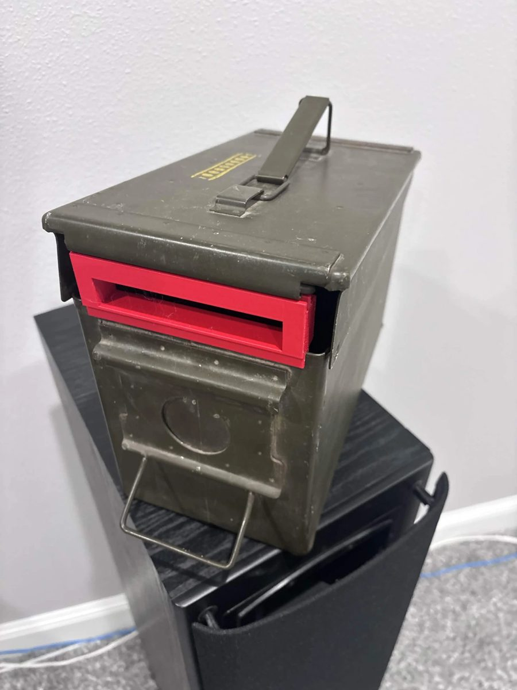
  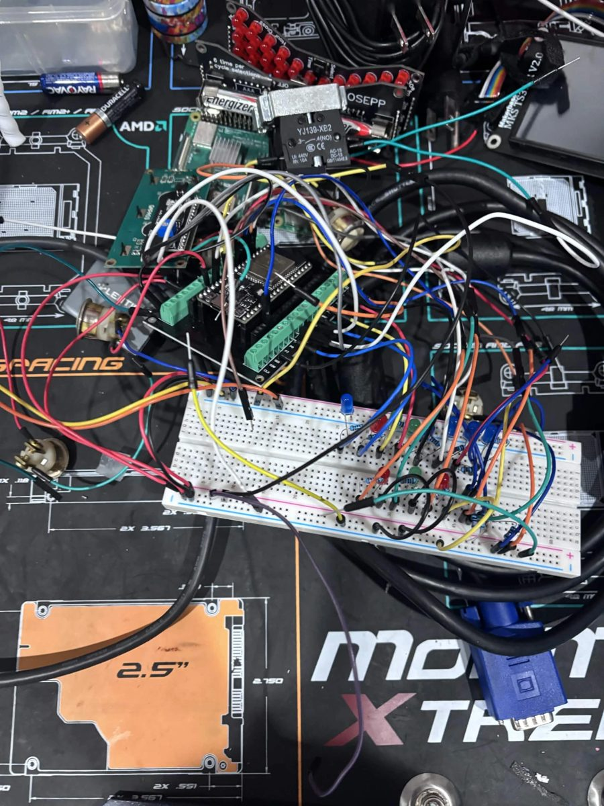
  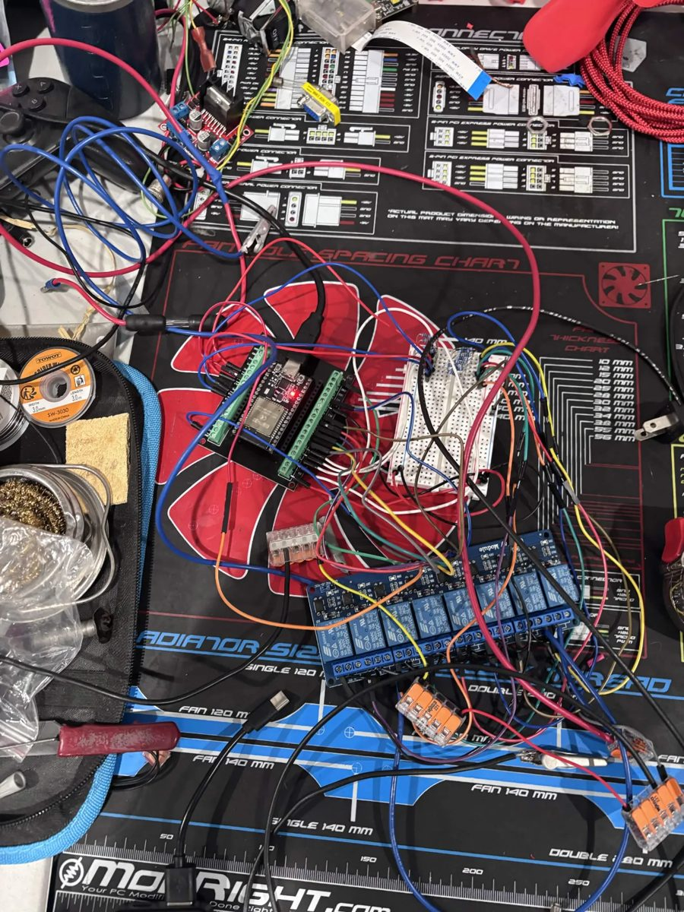
</p>

## How it works

```
  PANEL BOX (handheld)                          FIELD BOX (on the ground)
 ┌──────────────────────┐    ESP-NOW 2.4 GHz    ┌───────────────────────────┐
 │ ESP32                │ ── heartbeat/fire ──► │ ESP32                     │
 │ 8 fire buttons + LEDs│ ◄── status/contin. ── │ 8-ch relay board          │
 │ arming key, MODE btn │                       │ continuity sense per ch.  │
 │ 16x2 LCD, link LEDs  │                       │ 12 V SLA ─ fuse ─ relays  │
 │ 4x AA                │                       │          └─► igniters     │
 └──────────────────────┘                       └───────────────────────────┘
```

- The panel sends a heartbeat every 300 ms with the key position. The field box only
  fires while it's hearing a fresh ARMED heartbeat. If the heartbeat is more than 1.5 s
  old it cuts any pulse in progress and refuses new fire commands.
- The field box sends status 4 times a second: continuity for each channel, which relays
  are closed, and its uptime. The panel uses that to light the channel LEDs and to work
  out link quality.
- The two boards are paired by MAC address and only listen to each other.

### Key switch

| Position | What happens |
|---|---|
| Middle: **DISARMED** | Every relay open. MODE opens the settings menu. |
| Left: **ARMED** | Each button fires its own channel (SINGLE), or any button runs your saved sequence (PROGRAM). |
| Right: **ARMED ALL** | Any button starts a 3-2-1 countdown, then fires every ready channel. Turning the key aborts it. |

After power-up the key has to be seen in DISARMED once before it will arm, so the box
can't come up armed if you switch it on with the key in the wrong spot.

### Channel types

Each channel can be set in the menu (saved in flash):

- **FIRE**: pulses the relay for the channel's pulse length (0.1 to 10 s). For igniters.
- **ON/OFF**: press on, press off. For lights or inflatables.
- **HOLD**: relay on only while you hold the button. For fog or similar.

### Menu (key in DISARMED, press MODE)

btn1 = next, btn2 = back, btn3 = minus, btn4 = plus/start, MODE = back, hold MODE = exit.

1 Link status · 2 Ping test · 3 System check · 4 Continuity · 5 Channel setup ·
6 Link-lost hold · 7 Input test · 8 Info · 9 Reset settings

## What's in here

```
firmware/
  firework_controller/   panel box sketch
  firework_field/        field box sketch
hardware/
  pcb/                   KiCad 10 boards, generator + router scripts, gerber zips
    archive/             old two-board (tray + lid) controller design, not used anymore
  enclosure/             build123d scripts, STEP/STL files, print/fit test pieces
    inventor/            Autodesk Inventor parts (.ipt/.ipj) and the plate STLs
    archive/             earlier OpenSCAD versions
docs/                    wiring diagrams (.svg), wiring sheets (.html, open in a browser)
  images/                photos
  archive/               outdated sheets from the 7-segment version, don't build from these
```

## Parts list

What one complete set uses. The search terms are what to type into Amazon/AliExpress.

### Panel box (handheld)

| Qty | Part | Search for / notes |
|---|---|---|
| 1 | ESP32 38-pin dev board | "ESP32 NodeMCU ESP-32S 38 pin" |
| 1 | ESP32 screw-terminal breakout board | "ESP32 38 pin terminal expansion board". Saves soldering, every wire gets a screw |
| 1 | 16x2 LCD with I2C backpack | "1602 LCD I2C PCF8574". Address 0x27 or 0x3F |
| 1 | 3-position key selector switch, 22 mm | "22mm 3 position key selector switch XB2". Needs **two NO contact blocks** (YJ139-XB2 or similar), one per armed position |
| 8 | Momentary push buttons | Fire buttons. Any panel-mount momentary NO button |
| 1 | Momentary push button | MODE |
| 1 | Toggle switch with safety cover | Power. Mine is a KN3C-101 with the flip-up red cover |
| 8 | LEDs | Channel ready/on |
| 1 + 1 | Green LED, red LED | LINK status |
| 10 | 220 Ω resistors | One per LED |
| 4 | 10 kΩ resistors | Pull-ups for buttons 5-8 |
| 1 | 4x AA battery holder | NiMH rechargeables recommended |
| 1 | Half-size breadboard or perfboard | Resistors, LEDs, power rails |
| 1 | Case | I used a small lockable document case; the printed plate drops into a 9-3/8 x 6-1/4 in opening |
| 8+ | M2 x 6 screws | 4 plate-to-legs, 4 tray-to-legs, more if you screw boards down |

### Field box

| Qty | Part | Search for / notes |
|---|---|---|
| 1 | ESP32 38-pin dev board | Same as above, plus a screw-terminal breakout if you like |
| 1 | ELEGOO 8-channel 5 V relay module | Inputs are active LOW |
| 1 | 12 V SLA battery | Firing power, kept separate from the ESP32 power |
| 1 | Inline fuse holder + 10 A fuse | **The master safety.** No fuse, no firing power |
| 4 | 100 kΩ resistors | Sense pull-ups, channels 1-4 |
| 8 | 10 kΩ resistors | Sense series resistors, one per channel |
| 2-3 | Wago 221 5-slot lever connectors | The shared negative return bus |
| 16 | Alligator clips + wire | Two per channel |
| 1 | USB power source + cable | Powers the field ESP32 (a small power bank works) |
| 1 | Ammo can | About 11 in inside length; the printed floor and front window frame fit it |

### Optional

| Qty | Part | Notes |
|---|---|---|
| 2 | PCBs | Replace the breadboards: controller 100 x 84 mm, field 100 x 75 mm. See [PCBs](#pcbs) |
| - | Screw terminals (5.08 mm), 1x19 female headers, 1x10 pin header | For the PCBs |
| - | PETG or ASA filament | For the printed parts |

<p align="center">
  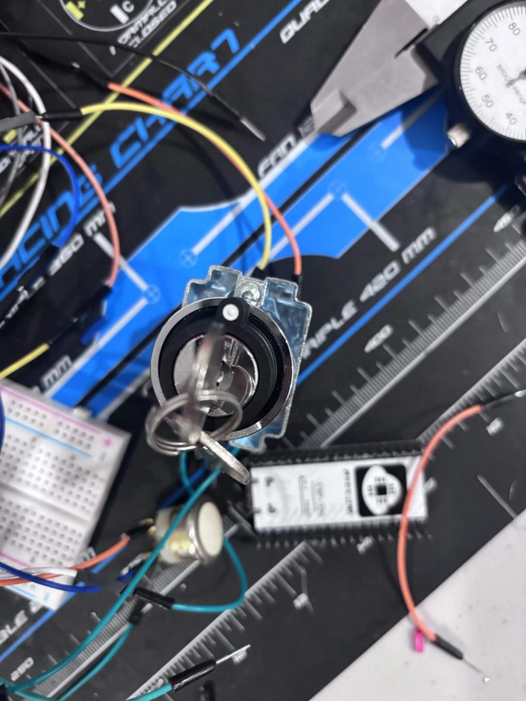
  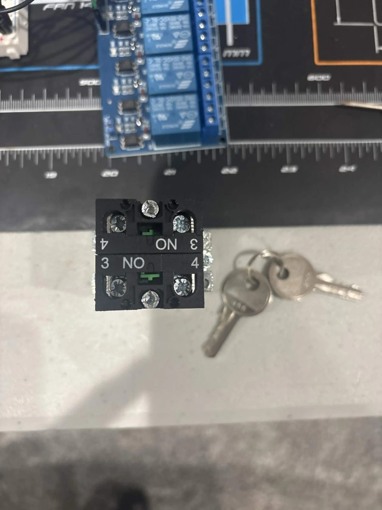
  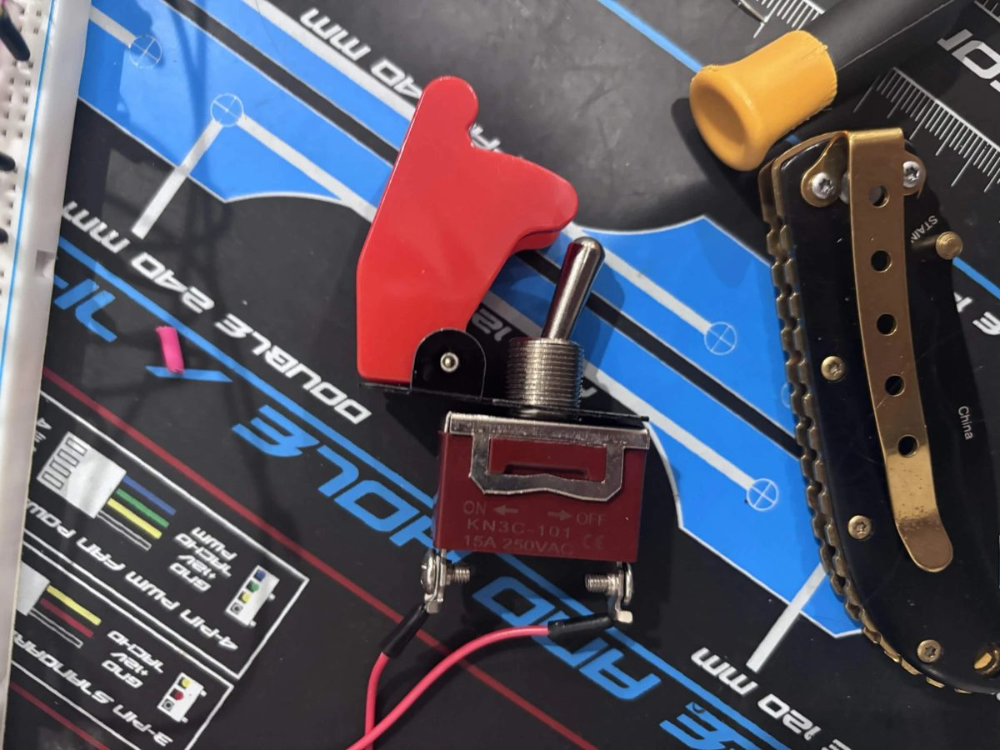
  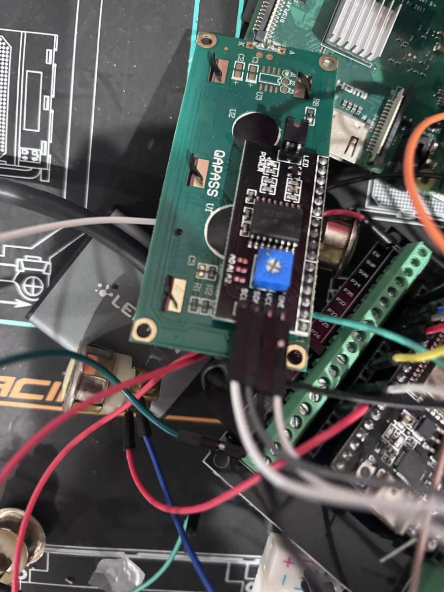
</p>

## Flashing the firmware

1. Install the [Arduino IDE](https://www.arduino.cc/en/software).
2. Add the ESP32 boards: **File → Preferences → Additional boards manager URLs**:
   `https://espressif.github.io/arduino-esp32/package_esp32_index.json`
   then **Tools → Board → Boards Manager**, search "esp32" and install **esp32 by
   Espressif Systems**. The sketches handle both the 2.x and 3.x cores.
3. **Sketch → Include Library → Manage Libraries**, install **LiquidCrystal I2C** by
   Frank de Brabander (panel box only).
4. Board: **ESP32 Dev Module**. Open `firmware/firework_controller/firework_controller.ino`,
   upload it to the panel ESP32. Open `firmware/firework_field/firework_field.ino` and
   upload it to the field ESP32.

### Pairing the two boards

The MAC addresses in the sketches are for my boards. Yours will be different.

1. Flash both sketches as they are and open **Serial Monitor at 115200 baud**.
2. Each board prints its own MAC at boot (`MY MAC - paste into ...`).
3. Put the **field** board's MAC into `FIELD_MAC` in `firework_controller.ino`.
4. Put the **controller** board's MAC into `CONTROLLER_MAC` in `firework_field.ino`.
5. Re-flash both. The green link LED should come on.

`44:1D:64:BD:75:50` becomes `{0x44, 0x1D, 0x64, 0xBD, 0x75, 0x50}`.

### Settings you might change

| Setting | File | Default | What it does |
|---|---|---|---|
| `FIELD_MAC` | firework_controller.ino | my board | MAC of your field box |
| `CONTROLLER_MAC` | firework_field.ino | my board | MAC of your panel box |
| `LCD_ADDR` | firework_controller.ino | `0x27` | Try `0x3F` if the screen stays blank (and turn the contrast pot) |
| `USE_LONG_RANGE` | **both** | `0` | `1` turns on ESP32 long-range mode. Must match on both boards |
| `MAX_PULSE_MS` | firework_field.ino | `10000` | Hard cap on any one pulse, whatever the panel asks for |
| `HEARTBEAT_TIMEOUT` | firework_field.ino | `1500` | Field disarms after this many ms without a heartbeat. Don't raise it |

Everything else (channel types, pulse lengths, continuity check, link-lost hold, the
saved sequence) is set from the menu on the panel and stored in flash.

If you change the message format, bump `PROTO_VER` in both sketches. Boards with a
different `PROTO_VER` ignore each other instead of misfiring.

## Wiring

These diagrams are drawn straight from the pin tables in the sketches
(`python docs/make_wiring.py .` redraws them if you change a pin). The step-by-step
sheets in [`docs/`](#docs) go wire by wire.

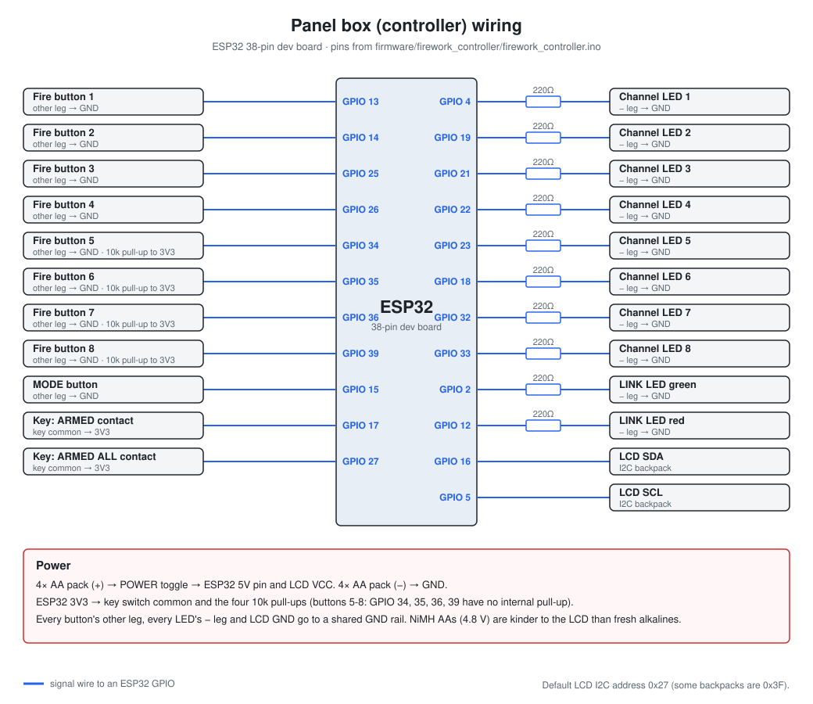

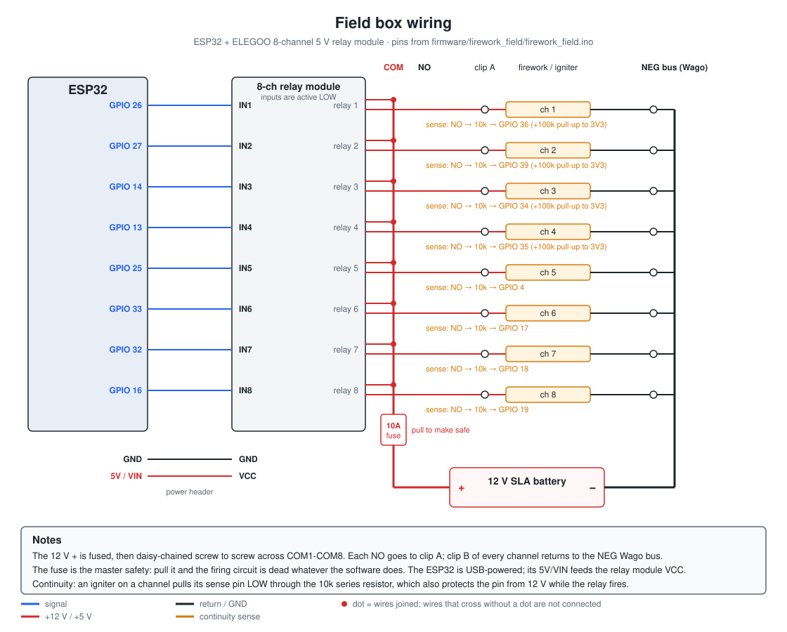

<p align="center">
  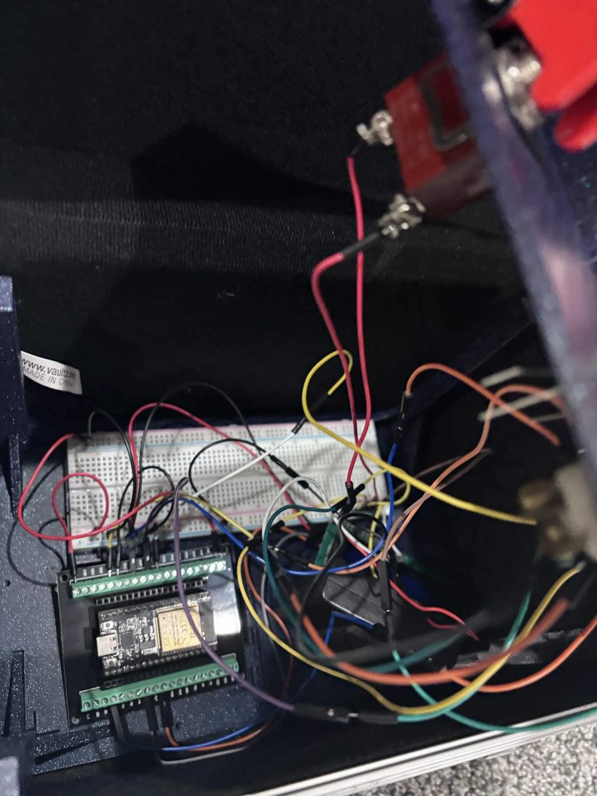
  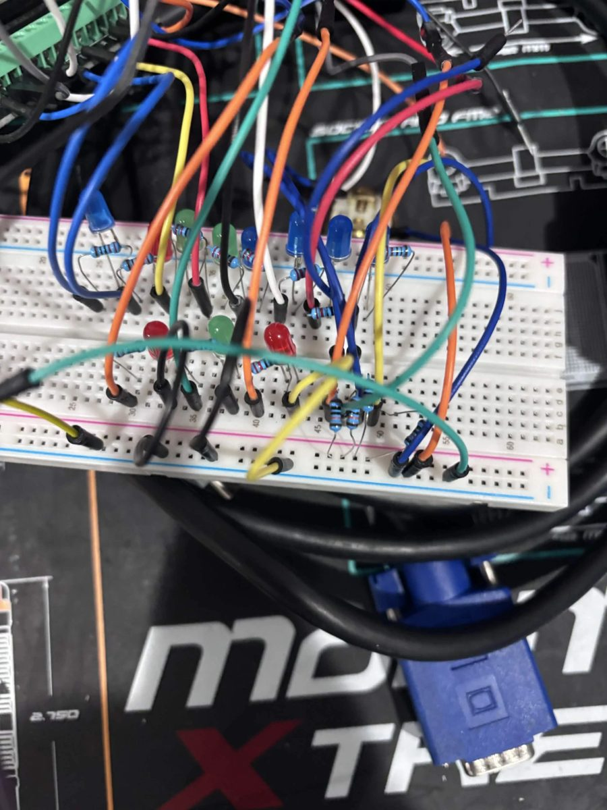
</p>

## Pin maps

### Panel box (`firework_controller.ino`)

| Function | GPIO |
|---|---|
| Fire buttons 1-8 (to GND) | 13, 14, 25, 26, 34, 35, 36, 39 (34-39 need an external 10 k pull-up to 3V3) |
| Channel LEDs 1-8 (220 Ω to GND) | 4, 19, 21, 22, 23, 18, 32, 33 |
| Key ARMED / ARMED ALL (key common to 3V3) | 17 / 27 |
| MODE button (to GND) | 15 |
| Link LED green / red | 2 / 12 |
| LCD SDA / SCL (LCD VCC to 5 V) | 16 / 5 |

### Field box (`firework_field.ino`)

| Channel | 1 | 2 | 3 | 4 | 5 | 6 | 7 | 8 |
|---|---|---|---|---|---|---|---|---|
| Relay IN (active LOW) | 26 | 27 | 14 | 13 | 25 | 33 | 32 | 16 |
| Continuity sense | 36 | 39 | 34 | 35 | 4 | 17 | 18 | 19 |

Each sense pin connects through a 10 k series resistor to that relay's NO terminal
(where the igniter's hot lead lands). Channels 1-4 need a 100 k pull-up to 3V3; 5-8 use
the ESP32's internal pull-up. An igniter in place pulls the pin LOW.

## PCBs

Both boards are generated by Python scripts that run inside KiCad's own Python, then
auto-routed with [freerouting](https://github.com/freerouting/freerouting).

| Board | Size | Files |
|---|---|---|
| Panel (controller) | 100 x 84 mm | `hardware/pcb/controller/` · `controller-gerbers.zip` |
| Field | 100 x 75 mm | `hardware/pcb/field/` · `field-gerbers.zip` |

**Ordering:** upload the gerber zip at [jlcpcb.com](https://jlcpcb.com) (or any other
fab). The defaults are fine: 2 layers, 1.6 mm, HASL.

**Before you order, measure your ESP32.** The boards assume the two pin rows are
25.4 mm (1.0") apart. Some dev boards are 22.86 mm (0.9"). If yours is different,
change `ESP_ROW_SPACING` at the top of the generator script and rebuild. Print
`field/field-paper-check-1to1.pdf` at 100% scale and set your parts on it to check
the fit.

**Rebuilding** (needs [KiCad 10](https://www.kicad.org/), Java and freerouting):

```
cd hardware/pcb
"C:\Program Files\KiCad\10.0\bin\python.exe" generate_controller.py
"C:\Program Files\KiCad\10.0\bin\python.exe" route_controller.py path\to\freerouting.jar
```

The scripts point to my KiCad install at `E:\KiCad`. Change `FP_ROOT` at the top of each
generator to your KiCad footprint folder. Running a generator **wipes the routing** on
that board, so always run the router after it. Then export gerbers from KiCad
(File → Fabrication Outputs) and zip them.

## Enclosure

The panel is a printed 9.2 x 6.1 in plate with an angled LCD pod, legs and an internal
parts tray, made to drop into a box with a 9-3/8 x 6-1/4 in opening. The field parts are a floor plate and a front window
frame for an ammo can.

### What to print

All in `hardware/enclosure/`. Print the `_test` pieces first: they're thin slices of the
real part, take a few minutes, and tell you if the fit is right before you spend hours
on the full print.

| File | Part | How to print |
|---|---|---|
| [`controller_full.stl`](hardware/enclosure/controller_full.stl) | Panel faceplate (1/8 in thick) with the 30° LCD pod, M2 counterbores in the corners | Plate bottom on the bed (as exported) |
| [`legs_print.stl`](hardware/enclosure/legs_print.stl) | Four corner legs + floor ring, one piece | As exported, floor ring on the bed |
| [`tray_print.stl`](hardware/enclosure/tray_print.stl) | Parts tray: breadboard corral, ESP32 corners, battery cradle | Slab down, no supports |
| [`field_floor.stl`](hardware/enclosure/field_floor.stl) | Insulating floor plate for the ammo can | Skirt up (top face on the bed), no supports |
| [`field_prop.stl`](hardware/enclosure/field_prop.stl) | Front window frame that clamps on the can rim; wires pass through it | Standing on its end with a brim, no supports |

Fit tests:

| File | Checks |
|---|---|
| [`controller_plate_test.stl`](hardware/enclosure/controller_plate_test.stl) | 1.5 mm slice of the faceplate: outline, every hole, LCD opening |
| [`legs_test.stl`](hardware/enclosure/legs_test.stl) | Floor ring and the bottom 15 mm of the legs: footprint on the box floor |
| [`field_floor_test.stl`](hardware/enclosure/field_floor_test.stl) | Floor outline in the can |
| [`field_prop_test.stl`](hardware/enclosure/field_prop_test.stl) | Rim and lid grooves of the window frame |

Pieces for CAD, not for printing on their own:

| File | What it is |
|---|---|
| `lcd_pod_30.stl` / `lcd_pod_30_placed.stl` | The LCD pod by itself (already joined into `controller_full`) |
| `lcd_pod_cutter.stl` / `lcd_pod_cutter_placed.stl` | The cut-out the pod needs in a plain plate |
| `inventor/Controller.stl`, `inventor/Controller_9.200x6.100.stl` | The plate exported from Inventor, before and after `shrink_plate.py` |
| `archive/*.stl` | Earlier OpenSCAD versions, kept for history |

Every printable part also has a `.step` file for CAD. PETG or ASA hold up better outdoors
than PLA, which can soften in a hot car or in direct sun.

To regenerate them you need Python 3 and build123d:

```
pip install build123d
cd hardware/enclosure
python legs_step.py
```

A few scripts copy their output into my Inventor folder (`E:\InventorProjects\...`)
or read the plate STL from there. If you don't have that folder, delete those
`shutil.copy` lines and point `SRC` at `inventor/Controller_9.200x6.100.stl`.

The base plate was modelled in Autodesk Inventor. The `.ipt` files are in
`hardware/enclosure/inventor/` if you have Inventor; everyone else can use the STEP/STL files.

## Docs

Open these in a browser:

- [`docs/CONTROLLER_WIRING.html`](docs/CONTROLLER_WIRING.html): panel box wiring, step by step
- [`docs/FIELD_WIRING_GUIDE.html`](docs/FIELD_WIRING_GUIDE.html): field box power and clip wiring
- [`docs/SCHEMATIC_field.html`](docs/SCHEMATIC_field.html): field box schematic
- [`hardware/enclosure/INVENTOR_BUILD.html`](hardware/enclosure/INVENTOR_BUILD.html): faceplate build sheet

Anything in `docs/archive/` is from the old 7-segment version and has wrong pins.

## Before every use

- Test with **no pyrotechnics connected**. Put an LED or test lamp across each channel's
  clips and fire every channel.
- Run **System check** from the menu. It should say PASS.
- Turn the key to DISARMED and **pull the fuse** before you walk up to the field box.
  Connect igniters last, fuse in last, and walk away before you arm.
- If something doesn't fire, disarm, pull the fuse, and wait before you approach.

## License

- Firmware and scripts: [MIT](LICENSE)
- Hardware designs (PCB, enclosure, Inventor files) and docs:
  [CERN-OHL-P v2](LICENSE-HARDWARE)

Both come with no warranty. See [DISCLAIMER.md](DISCLAIMER.md) as well. By using
anything in this repo you accept that you do so entirely at your own risk.
